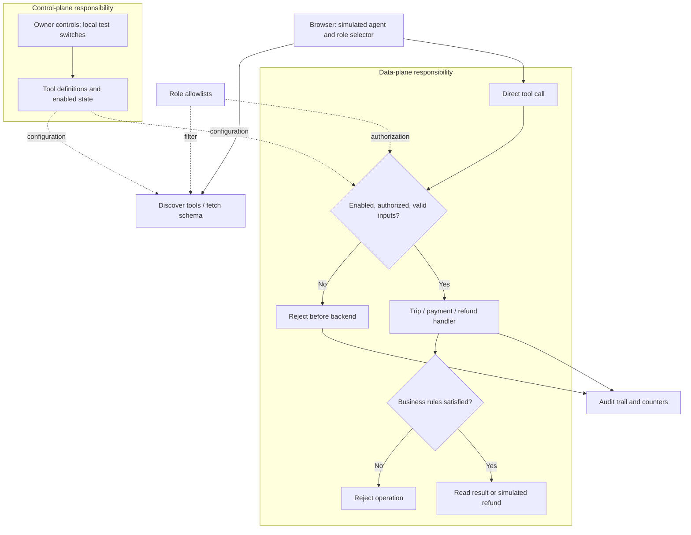
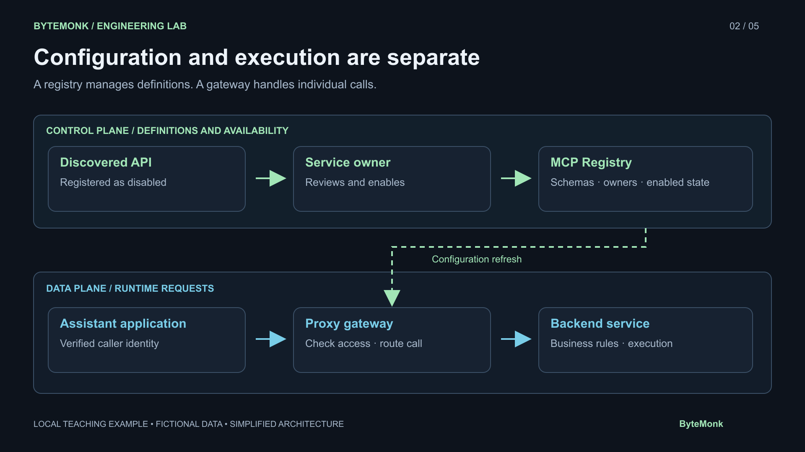

# Uber MCP 5000 — ByteMonk hands-on lab

**One request. Two roles. Watch where it gets stopped.**

This companion lab takes a large system-design problem and makes it small enough to explore on your laptop: how can an AI assistant find useful tools without getting permission to do everything?

You will discover a trip-reading tool, inspect its inputs, run a successful read, and attempt the same refund under two roles. Visible counters and an audit trail show whether the backend actually ran. Allow about **10–15 minutes**. Basic familiarity with APIs helps; no AI account or cloud setup is needed.

## Why Uber is the starting point

Uber describes an MCP Gateway serving more than 5,000 tools across more than 800 MCP servers. Its gateway brings discovery, access checks, and routing together, connecting MCP callers to existing services that use HTTP, gRPC, and TChannel. A registry manages tool information, while a proxy handles live calls. Read [Uber’s engineering article](https://www.uber.com/us/en/blog/designing-mcp-gateway/) for the production design.

The challenge becomes easier to see as a company grows: different teams own different APIs, change them independently, and need different access rules. A shared gateway gives callers a consistent entry point. It also becomes a component whose availability, configuration freshness, and ownership matter to every caller.

**This repository contains three fictional tools, not 5,000.** The name refers to the video’s Uber case study. This is an independent teaching simulation, not Uber source code or a complete MCP protocol implementation. It makes no LLM calls, uses no credentials, and moves no real money.

## A few terms before you click

- **Tool:** an operation software makes available to an assistant, such as `get_trip`.
- **Schema:** the operation’s input instructions: field names, types, and required values.
- **Tool call:** a structured request containing a tool name and its arguments. A model can choose the request; software executes it.
- **MCP:** Model Context Protocol, a standard for communication between an AI application's client and a server exposing capabilities such as tools. This lab uses ordinary local HTTP endpoints to demonstrate gateway decisions; it does not implement an MCP handshake or transport.
- **Gateway:** the entry point that checks a request and routes an allowed call to the operation that performs it.

## Architecture: configuration and live requests

Think of a building’s reception desk. Someone maintains the directory and access rules; the receptionist uses those rules when a visitor arrives. Those are different responsibilities, even if they happen in the same building.

The **control plane** manages configuration: which tools exist and whether they are enabled. The **data plane** handles actual calls using that configuration. In this small lab, both live in one Node.js process. The diagram separates responsibilities, not machines.



Discovery only helps a caller find tools. It is **not** the security boundary. Someone can skip discovery and submit a known tool name directly, so the gateway checks access again at execution time. The refund handler then checks business rules: the amount must match the full fare and a trip cannot be refunded twice.

In a larger deployment, many gateway instances can use distributed configuration. Local copies avoid a configuration lookup on every call, but then updates must reach those copies. This lab does not simulate replication, network failures, or distributed caching.

## 1. Start the lab

Install **Node.js 20 or newer** and Git, then run:

```bash
git clone https://github.com/bytemonk-academy/uber-mcp-5000.git
cd uber-mcp-5000
node --version
npm start
```

There are no third-party dependencies, so `npm install` is unnecessary. You can also download the repository ZIP, extract it, and open a terminal in that folder. On macOS, `Start-Demo.command` is a convenience launcher if Node is on your PATH.

Open **http://127.0.0.1:4318**. Keep the terminal running; press Ctrl+C there to stop the server. Use `127.0.0.1` exactly, rather than `localhost`, because the demo checks the request host.

## 2. Meet the tools and roles

| Tool | What it does | Support Viewer | Refund Operator |
| --- | --- | --- | --- |
| `get_trip` | Reads a trip and its fare | Allowed | Allowed |
| `get_payment` | Reads payment and refund status | Allowed | Allowed |
| `issue_refund` | Creates a simulated full refund | Denied | Allowed |

Use **TRIP-1042** throughout. Its fictional fare is **2400 cents ($24.00)**. The role dropdown is a testing shortcut, not a login system. In production, caller identity must come from verified authentication.

## 3. Discover the read tool

1. Click **Reset demo** and confirm **Support Viewer** is selected.
2. In **Tool catalogue**, keep the search text `get_trip` and click **Discover**.
3. Click **Fetch schema** on the result.
4. Notice the required `trip_id` input. Expand **Full schema** if you want to inspect the JSON.

You have found the tool and learned how to call it. Neither step executes a backend handler: the counters remain **0 backend calls / 0 refunds**.

## 4. Read the trip

1. In **Direct tool call**, select `get_trip`.
2. Enter `TRIP-1042` as the trip ID.
3. Click **Run tool call**.

The read succeeds. The result shows the cancelled trip, the path reaches the backend, and the audit trail includes a completed read. Pause here: **1 backend call / 0 refunds**.

The amount field is used only for refunds. Reading a trip does not send that amount as an argument.

## 5. Try a refund as the viewer

1. Keep **Support Viewer** selected.
2. To check discovery, search for `issue_refund` and click **Discover**: it is unavailable to this role.
3. In **Direct tool call**, select `issue_refund` anyway. This deliberately lets you bypass the catalogue.
4. Keep `TRIP-1042` and enter `2400` cents.
5. Click **Run tool call**.

The gateway rejects the request. Check the audit event and counters: **1 backend call / 0 refunds**, unchanged from the read. The refund handler never ran. This is why hiding a tool in the interface cannot replace server-side authorization.

## 6. Retry the same request as the operator

1. Change **Demo role** to **Refund Operator**.
2. Leave the tool, trip ID, and amount unchanged.
3. Click **Run tool call**.

Now the request succeeds: **2 backend calls / 1 refund**. Expand **Refund records** to inspect the simulated record. The audit trail shows that the gateway allowed the call and the backend created the refund.

Only the role changed. The request itself stayed the same.

## 7. See why permission is only one check

Click **Run tool call** again as the operator. The gateway still allows this caller, but the backend rejects the duplicate refund. You now see **3 backend calls / 1 refund**.

The distinction matters: a gateway denial prevents handler execution, while a business-rule rejection happens after the handler starts. The backend-call counter counts handler entries, including rejected operations; it is not a success counter.

For another experiment, reset, select the operator, expand **Owner controls**, and disable `issue_refund`. Even the operator is now denied before the backend. Tool availability, caller permission, and business validity answer three different questions.

### Checkpoints for the video walkthrough

| Moment | Backend calls | Refund records |
| --- | ---: | ---: |
| Reset, discover, fetch schema | 0 | 0 |
| Viewer reads trip | 1 | 0 |
| Viewer attempts refund | 1 | 0 |
| Operator retries same refund | 2 | 1 |
| Optional: operator repeats refund | 3 | 1 |

These counts assume you follow the sequence without extra tool calls. Reading payment details also increments the backend counter. Reset to start a fresh take.

## 8. Explore schema sizes

Open **Schema sizes** to compare loading every schema with discovering and fetching one.

| Strategy | Initial input | Cumulative input | Snapshots |
| --- | ---: | ---: | ---: |
| All three schemas | 1,178 bytes | 1,178 bytes | 1 |
| Discover, then fetch one | 786 bytes | 3,346 bytes | 3 |

The incremental approach starts smaller but sends more cumulative input in this three-tool fixture. Discovery has overhead; it is not automatically a saving.

Each value measures compact UTF-8 JSON with `Buffer.byteLength(JSON.stringify(snapshot), 'utf8')`. The incremental path includes helper-tool definitions, discovery results, the selected schema, and repeated conversation history. Totals stop at tool selection, before executing the business tool. Open **Measurement details → Download inputs** to inspect the exact snapshots; the repository also includes [schema-measurement.json](schema-measurement.json).

These are illustrative serialized input sizes, **not measured tokens, model billing, latency, caching benefits, or network traffic**. No model is called. A larger catalogue could produce a different tradeoff; measure your actual inputs before drawing conclusions.

## Visuals for learning or recording

Open **Architecture** in the app to select a diagram, present fullscreen, or download PNG/SVG versions. The files also live in [public/visuals](public/visuals).



The architecture artwork explains the broader design; the Mermaid diagram above maps the smaller implementation in this repository.

## Find your way around the code

| File | Start here to understand… |
| --- | --- |
| [gateway.mjs](gateway.mjs) | Tool schemas, role allowlists, discovery, runtime checks, business rules, byte measurements |
| [server.mjs](server.mjs) | Local HTTP routes, mock sessions, loopback restrictions, static files |
| [public/app.js](public/app.js) | Browser actions, result display, audit trail, diagrams |
| [public/style.css](public/style.css) | ByteMonk black, purple, and gold theme |
| [test.mjs](test.mjs) | Executable examples of allowed and rejected calls |

Run the checks in a second terminal:

```bash
npm test
```

The six tests cover read/write permissions, duplicate refunds, disabled tools, invalid inputs and roles, reset behavior, and serialized-byte totals.

## Troubleshooting and boundaries

| Symptom | What to do |
| --- | --- |
| Browser cannot connect | Run `npm start` from this folder and leave that terminal open. |
| Host rejected | Open `http://127.0.0.1:4318`, not `localhost`. |
| Port already in use | Stop the previous demo with Ctrl+C or choose another port below. |
| Counts differ from the walkthrough | Reset and repeat; extra reads also count. |
| State disappears | Expected: all data is in memory and resets on restart. |

Alternate port on macOS/Linux:

```bash
PORT=4319 npm start
```

On Windows PowerShell:

```powershell
$env:PORT = "4319"
npm start
```

Then open `http://127.0.0.1:4319`.

This lab binds to your computer’s loopback address. Role selection, owner switches, and reset are intentionally available without authentication. Mock sessions use a cookie, but everyone shares the same in-memory trip, refund records, and audit log. Reset clears all sessions. Do not treat this as a production authorization service or expose it publicly.

To extend the exercise, ask: how would you verify the caller’s identity, distribute configuration updates, handle gateway outages, and prevent duplicate refunds across multiple backend instances? Those are the next system-design problems beyond this local demonstration.
